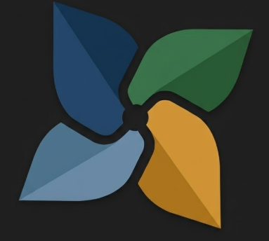
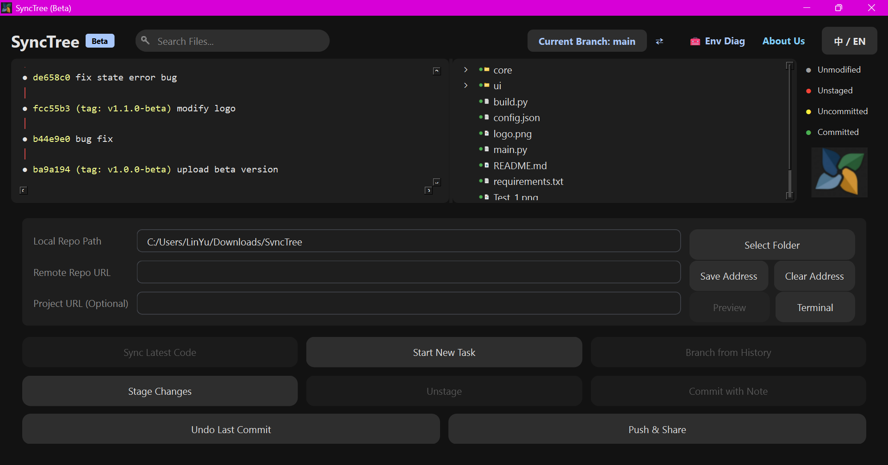

<div align="center">
  
  <h1>SyncTree (Beta)</h1>
  
  <p>
    <a href="https://github.com/AndrewWangDev/SyncTree/actions"></a>
    <a href="https://github.com/AndrewWangDev/SyncTree"></a>
    <a href="LICENSE"></a>
    <a href="https://www.python.org/"></a>
  </p>
</div>

**SyncTree** is a lightweight, fully fool-proof Git graphical desktop client developed based on `PySide6`.  
It is tailored for Git beginners and developers who need a pure, zero-mental-burden code version management tool.

<div align="center">
  
  <p><i>Main Interface Overview</i></p>
</div>

---

## 🚀 Core Features

- **Ultimate Fool-Proof Interaction**: Based on a strict state machine polling mechanism (background checking via `QTimer`), any operation buttons that do not conform to the current Git state will be automatically disabled (semi-transparent), rejecting all error tree states caused by incorrect command combinations.
- **Modern Material You Dark UI**: An immersive dark theme, custom-drawn water ripple button effects, discarding the traditional system `QMessageBox` in favor of a home-brewed `Modal` with a smooth fade-in blurred background, and unobtrusive bottom `Toast` notifications.
- **Git Graph (ANSI Color Parsing)**: Transforms standard `git log` output by parsing ANSI terminal color escape codes at the UI layer, rendering them smoothly using Unicode monospace geometric characters (`●, │`).
- **Automated PR / MR Generation**: Native silent execution of background commands when pushing code, supporting intelligent regex sniffing of GitLab/GitHub generated Pull Request URLs and opening them directly in the default browser to share with the team seamlessly.
- **Multi-Language Support (EN/CN)**: An independent `i18n` module supports dynamic language switching and instant UI re-rendering.
- **Rich Diagnostic Toolkit**: Integrates deep connection probing mechanics that ping loopback adapters, resolve network APIs automatically, and evaluate potential firewall blockers when diagnosing asynchronous sync/push failures.

---

## 🛠 Technology Stack

- **Python 3.10+** (Core Development Language)
- **PySide6** (Qt for Python, cross-platform modern high-performance GUI and animations)
- **Subprocess Module** (Interacting with native Git core binaries with `CREATE_NO_WINDOW` flags to prevent command console popups)

---

## 📦 Project Structure

```text
SyncTree/
├── requirements.txt      # Dependency package list
├── build.py              # PyInstaller packaging & build script
├── main.py               # Project application entry point
├── core/
│   ├── config.py         # User local configuration & persistence
│   ├── git_actions.py    # Git command execution strategies & thread coordination
│   ├── git_utils.py      # Background QThread state polling & GitRepoLock mutex
│   ├── i18n.py           # Internationalization language dictionaries
│   ├── network_diag.py   # Connectivity diagnostics thread utility
│   └── state.py          # Core Git state data models (GitState)
└── ui/
    ├── components/
    │   ├── buttons.py    # Material You ripple animated buttons & logo
    │   ├── modals.py     # Modals, dialogs, overlays, blur processing
    │   └── toast.py      # Non-intrusive notification popups
    ├── graph_view.py     # Git graph rendering engine
    ├── panel_view.py     # Working pipeline panel and operation buttons
    ├── theme.py          # Material You dark palette & stylesheets
    └── window.py         # MainWindow main UI coordinator
```

---

## 🏃 Quick Start

### 1. Prerequisites

Ensure your operating system has native **Git** installed (`git --version`), along with a **Python 3.10+** runtime.

### 2. Download and Run

```bash
git clone https://github.com/AndrewWangDev/SyncTree
cd SyncTree
pip install -r requirements.txt
python main.py
```

### 3. Build as Standalone Executable

```bash
python build.py
```

> The standalone binary output will be generated in `dist/synctree.exe`.

---

## 📄 License

This project is licensed under the **[GNU General Public License v2.0 (GPL-2.0)](LICENSE)**.  
SyncTree operates as an interface wrapper communicating with native Git core binaries, conforming directly with open-source software distribution constraints.

---

## 👨‍💻 Author

Developed & maintained with ❤️ by **[Andrew Wang Dev](https://andrewwangdev.com/about/)** (`me@andrewwangdev.com`).
